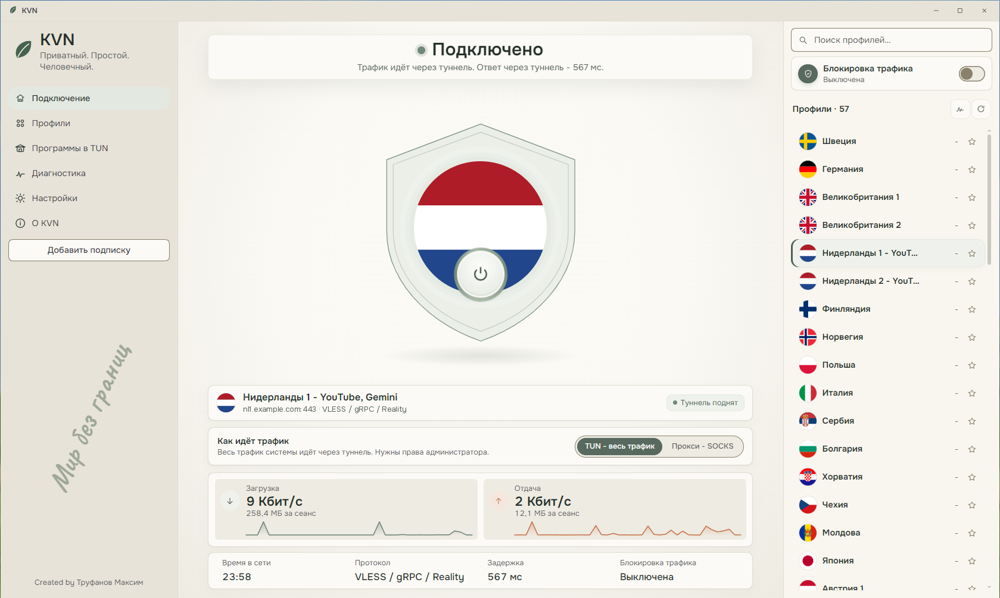
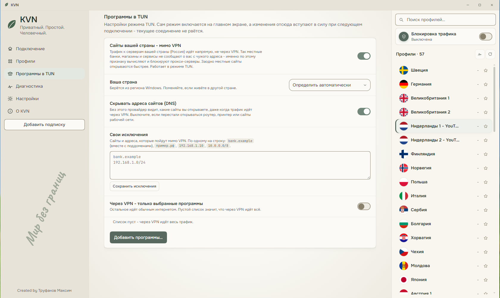

<div align="center">

# KVN

**Private. Simple. Human.**

VPN client for Windows and Android

[Русский](README.md) · **English** · [中文](README.zh.md)

### [⬇ Download for Windows and Android](https://github.com/DjFatMaxx/KVN-VPN-Client/releases/latest)

</div>



On a phone - [KVN for Android](#android).

KVN connects to the servers of your VPN provider: paste your
subscription, press "Connect" - done. Free, no ads, no sign-up.

> Screenshots show the Russian interface. KVN also speaks English and
> Chinese - switch on the first screen or in "Settings".

## In short

> [!TIP]
> **Why it is convenient**
> - One button instead of settings: subscription, "Connect", that's it.
> - Banks, government services and marketplaces keep working with the VPN
>   on: sites in your country open directly, without it.
> - Your internet provider cannot see which sites you open through the
>   VPN.
> - You can route just Telegram through the VPN - in two clicks.
> - The "What is wrong?" button tells you in plain words what broke and
>   whom to contact.
> - On a phone it switches to mobile-network servers by itself when the
>   usual ones do not answer there, and goes back on Wi-Fi.
>
> [More](#useful)

> [!NOTE]
> **Privacy**
> - No account, no ads, no telemetry: nothing is sent to the developer.
> - Subscriptions and keys stay on your computer only, encrypted.
> - Another program on your computer cannot secretly go through your VPN
>   and learn your server address.
>
> [More](#privacy)

> [!WARNING]
> **Honest about limits**
> - The file is not signed: Windows shows a warning on first launch,
>   Android asks to allow installing from the browser.
> - Browsers and Telegram calls do not work in "Proxy" mode - use TUN
>   mode for them.
> - KVN for Android is not on Google Play - only the APK from here.
>
> [More](#limits)

---

## What you need on Windows

- Windows 10 (22H2) or Windows 11, 64-bit.
- Administrator rights: KVN creates a network adapter.
- A subscription or link from your VPN provider. Almost anything issued
  for Happ, v2rayN or Hiddify works: VLESS (including Reality), VMess,
  Trojan, Shadowsocks, Hysteria2, SOCKS5. Amnezia keys (`vpn://...`),
  WireGuard and OpenVPN will not work - those are other protocols.

## Installing on Windows

1. Download `KVN-Setup-1.0.1.exe` from the
   [releases page](https://github.com/DjFatMaxx/KVN-VPN-Client/releases/latest).
2. Run it. Windows shows a blue "Windows protected your PC" window -
   click **"More info"**, then **"Run anyway"**. [Why](#smartscreen).
3. Choose a folder - the default is `Program Files`, keep it - and press
   **"Install"**.
4. **"Finish"** - KVN appears on the desktop and in the Start menu.

Nothing else to download: if Windows lacks the Microsoft WebView2
component (the KVN window runs on it), the installer adds it by itself.
The installer takes its language from Windows, and KVN opens in the same
language.

## First launch

1. **"Add subscription"** - paste the link from your provider
   (`https://...` or `vless://...`, several at once is fine).
2. **"Pick the fastest"** - KVN checks the servers and marks the fastest
   one. Or pick a server yourself.
3. The big button in the middle - **"Connect"**.

Closing the window does not turn the VPN off: KVN goes to the tray, next
to the clock. To exit - right-click the icon, "Quit KVN".

<a id="useful"></a>
## What it can do



**Banks and government services keep working.** Sites in your country
open directly, outside the VPN - local services see your usual address
and do not block the login. KVN takes the country from the Windows
region and names it on the first screen; change it under "Apps in TUN".

**Your provider does not see your sites.** Out of habit Windows also
asks for site addresses outside the VPN - that is how a provider learns
where you go even with a VPN on. The "Hide site addresses (DNS)" setting
closes this and is on from the start. Sites in your country go directly
and your provider sees them - they are reached directly anyway.

**Your own exceptions.** A site that should open without the VPN can be
pasted straight from the browser's address bar - its subdomains go with
it.

**Always through the VPN.** The opposite list: a site in your country
that should still go through the VPN (for example, to see the VPN
server's address) - even while the other sites of your country go
directly.

**Only the programs you need go through the VPN.** Choose, for example,
a browser and Discord - only they use the VPN, everything else goes
directly. A program can be picked from the list of running ones - with
icons and clear names, no hunting for the exe in folders.

**Two modes.**
- **TUN - all traffic** (default): the whole computer goes through the
  VPN. Needed almost always.
- **Proxy - SOCKS**: only programs you set up yourself go through the
  VPN. Handy for Telegram alone: the **"Add to Telegram"** button opens
  Telegram Desktop with the address, login and password already filled
  in. The password is permanent - nothing to re-enter after a restart.

**Traffic blocking.** When on, internet without the VPN is closed
completely: if the connection drops, nothing leaks out directly until
you bring it back. Off by default.

**Small things that save time.**
- Latency is measured through the server itself - the number you will
  get after connecting, not "1 ms" to the nearest router. It says which
  network it was measured on; when the network changes, old numbers are
  cleared.
- Moved to another network (home, office, cable) - KVN reconnects to the
  same server by itself, so your country's sites use the new network's
  DNS.
- Country databases (which sites and addresses are "yours") update by
  themselves, without a new KVN version, and are checked by signature.
- Remaining traffic and subscription end date are shown in the list if
  your provider reports them. KVN warns three days before the end.
- Start with Windows - straight to the tray, optionally connected.
- Shortcuts from anywhere: `Ctrl+Alt+Shift+V` - connect or disconnect,
  `Ctrl+Alt+Shift+K` - show the window.
- A backup of all servers and settings in one password-protected file -
  for moving to a new computer.
- Русский, English, 中文.

## If something does not work

**Start with "What is wrong?"** under "Diagnostics". KVN checks
everything step by step and tells you in plain words where the problem
is: the subscription ended, the server does not answer, the connection
from your network does not reach the server, an antivirus removed files.

**The internet is gone and KVN will not open** (only possible with
traffic blocking on). Restart the computer - the blocking does not
survive a restart. Or run `UNBLOCK-KVN.bat` from the KVN folder.

**Reporting a problem.** Under "Diagnostics" press "Copy the report":
server addresses, keys and site names in it are already replaced with
placeholders. Paste it into your message.

Write to [trufanovma@yandex.ru](mailto:trufanovma@yandex.ru).

## Updating and removing

**Updating.** Once a day KVN checks for a new version and tells you. It
downloads nothing by itself. To update, download the new installer and
run it: it closes KVN by itself (the VPN disconnects meanwhile) and puts
the new version into the same folder. Servers and settings are kept.

**Removing.** Windows "Settings" - "Apps" - KVN - "Uninstall".
Everything KVN created goes away, including autostart and Windows rules.

<a id="privacy"></a>
## Privacy

- **No accounts, ads or telemetry.** KVN sends nothing to the developer.
- **Everything stays with you.** Subscriptions, keys and settings live
  only on this computer and are encrypted by Windows.
- **Where KVN connects by itself - the full list:**
  - your subscription - when updating (on a timer - only through the
    VPN);
  - Cloudflare, Google or Quad9 (DNS-over-HTTPS) - to find a server's
    address and country;
  - `gstatic.com` - when checking latency, through the server being
    checked;
  - GitHub - once a day, for the latest version number and fresh country
    databases if they are out (can be turned off in settings).
- **The proxy is password-protected.** Most VPN clients leave an open
  entrance on the computer through which any program can go around your
  settings and learn your server address. KVN closes it with a login and
  password, and every installation gets its own port.
- **The report is anonymised.** The help report goes nowhere by itself -
  only if you copy it. Server addresses, keys and site names in it are
  replaced with placeholders.
- **Unprotected subscriptions are flagged.** KVN accepts an `http://`
  subscription but says plainly: the link with your token is visible to
  everyone along the way.

<a id="limits"></a>
## Honest about limits

- **The file is not signed.** A developer certificate costs money and is
  issued to a company, so Windows warns on first launch.
  [How to check the file](#smartscreen).
- **"Proxy" mode is not for browsers and calls.** Chrome, Edge and
  Firefox cannot use a proxy with a password, and Telegram calls do not
  pass through such a proxy. Use TUN mode for them.
- **Programs on this computer can see that a VPN is on** - by the
  network adapter and the core process. No client hides this.
- **"Only selected programs" is not a guarantee.** Programs are matched
  by file name: two browsers named `chrome.exe` go together. Windows
  sometimes cannot link very short connections to a program in time, and
  they go directly.
- **Computer sleep.** After a move to another network KVN reconnects by
  itself, and after sleep on the same network the tunnel simply keeps
  working. This has not been checked on many machines yet: if sites do
  not open after sleep, disconnect and connect again - and tell us, it
  helps.
- **Fragmentation** - a setting for an unstable connection to the
  server - does not help on every network.
- **Windows traces.** After removal, records kept by Windows itself stay:
  the network adapter driver, network entries, network usage history. No
  program removes them.

<a id="smartscreen"></a>
## Why Windows warns

Windows greets unsigned programs with a blue SmartScreen window on first
launch. Click "More info" - "Run anyway".

To make sure the file is from here: open the folder it was downloaded
to, click the Explorer address bar at the top, type `cmd` and press Enter.
In the window that opens run

```
certutil -hashfile KVN-Setup-1.0.1.exe SHA256
```

The string of letters and digits must match the SHA256 in the release
description. If it does not match - do not run it.

An antivirus may be wary too: KVN creates a network adapter and starts
the Xray core. Add KVN to exceptions only if the checksum matched.

<a id="android"></a>
## KVN for Android

**What you need.** Android 8 or newer, a phone or tablet with an ARM
processor (almost all of them). The same subscription as for your
computer.

**Installation.**
1. On the phone, open the
   [releases page](https://github.com/DjFatMaxx/KVN-VPN-Client/releases/latest)
   and tap `KVN-1.0.1.apk`.
2. Open the downloaded file. Android asks whether the browser may install
   apps - allow it (this applies to the browser only, you can turn it off
   later).
3. **"Install"**. Google Play Protect may ask about an app from an
   unknown developer - **"Install anyway"**.
4. Open KVN, paste your subscription or scan its QR code - and the big
   button in the middle.

Already have KVN on a computer - on the phone tap "+", "Transfer from PC (backup)" and
pick the backup from KVN for Windows: subscriptions and servers move
together with your choice.

**What it does.**
- Sites and apps of your country go directly, the rest through the VPN,
  as on the computer; your own exceptions and "Always through VPN" too.
- Split by apps both ways: "only the chosen ones through the VPN" or
  "all except the chosen ones" (banks and government apps around the
  VPN).
- Mobile network: if the usual server does not answer there, KVN
  switches by itself to a mobile-network server (marked "LTE" or
  "whitelist" by the provider) and goes back on Wi-Fi.
- Switching servers does not drop the VPN: no traffic goes out directly,
  not even for a second.
- A quick settings tile, Android always-on VPN and "Block connections
  without VPN".
- Subscriptions update by themselves, only through the VPN - you choose
  how often.
- Latency is measured through the server, marked with the network; time
  online on the main screen.
- Once a day KVN checks for a new version and gives you a link to the
  APK. It installs nothing by itself.
- Русский, English, 中文.

**Honest about limits.**
- Not on Google Play: update with a new APK from here, over the old one -
  servers and settings are kept.
- Some phone skins (Xiaomi, Huawei, Honor, Samsung and others) unload a
  VPN in the background to save battery. KVN settings have a button and
  a hint on what to turn on for your phone.
- The APK is signed with the author's key: check it is from here by the
  SHA256 in the release notes.

## Support the author

In the KVN window - click the author's name at the bottom of the side
panel.

## Built with

[Xray-core](https://github.com/XTLS/Xray-core) (MPL-2.0) - connection
core, [Wintun](https://www.wintun.net) - network adapter,
[Wails](https://wails.io) (MIT) - window,
[flag-icons](https://github.com/lipis/flag-icons) (MIT) - flags, fonts
Onest, JetBrains Mono, Caveat, Ma Shan Zheng (SIL OFL 1.1).

KVN is free; the source code is closed.
